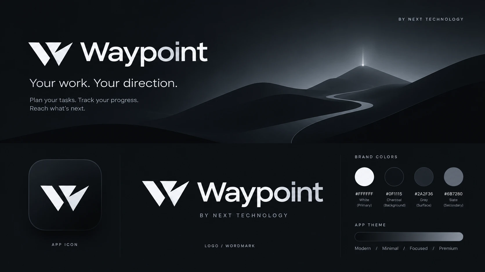
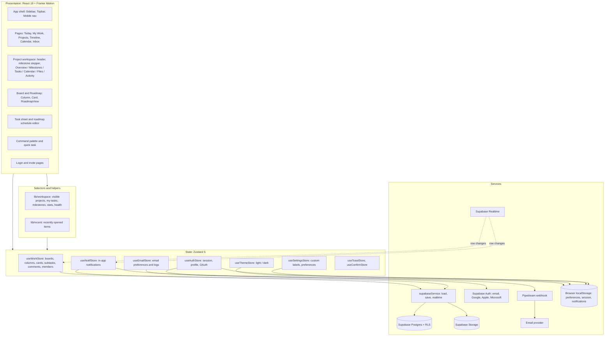
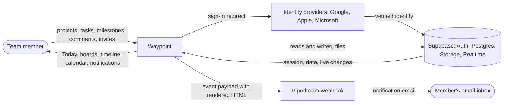
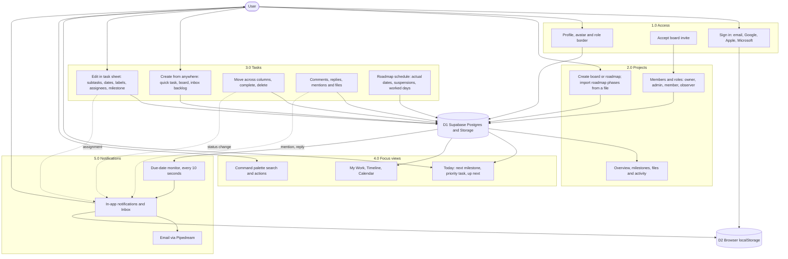

<div align="center">

  

  <h1>Waypoint</h1>
  <p><strong>Your work. Your direction.</strong><br />
  Plan your tasks. Track your progress. Reach what's next.</p>
  <p><sub>By Next Technology</sub></p>

</div>

---

## Contents

1. [Overview](#overview)
2. [Features](#features)
3. [Design language](#design-language)
4. [Getting started](#getting-started)
5. [Configuration](#configuration)
6. [How data is stored](#how-data-is-stored)
7. [System architecture](#system-architecture)
8. [Data flow diagrams](#data-flow-diagrams)
9. [User stories](#user-stories)
10. [Project structure](#project-structure)
11. [Tech stack](#tech-stack)

---

## Overview

Waypoint is a project workspace built around **milestones, not just tasks**. Every project is a journey: tasks move across a board, the moments that matter are marked as milestones, and the app keeps you focused on what moves the work forward today.

It is a single-page React app backed by Supabase (auth, Postgres, storage and realtime sync). Without Supabase configured it runs fully in the browser in a local demo mode, which is handy for trying it out.

---

## Features

### Today
The home screen answers "what should I do next?"

- **Make progress.** headline with a greeting and a short summary (active projects, due today, overdue).
- **Your next milestone**: the nearest open milestone across all projects (or the next active project), with progress, due date and shortcuts to open it.
- **Today's direction**: the single most important task for you right now, ranked by overdue, due date and urgency, with "Done" and "Focus this task".
- **Up next**: your upcoming deadlines as a vertical timeline.
- **Upcoming milestones**, **In motion** (every project with owners, progress and due date) and **Recent signals** (latest activity).

### My Work
Every task assigned to you across all projects, grouped by **Overdue / Today / This week / Later / No due date**. Switch between "Assigned to me" and "All tasks", or view completed work. Tasks can be ticked off in place.

### Projects
A grid of every board and roadmap with a cover, progress, task count, due date and team. Filter by All / Boards / Roadmaps / Completed, search by name, rename, delete or leave a project, and select several projects to delete at once.

Two project types:
- **Task board**: Kanban columns for day-to-day work, plus a backlog Inbox.
- **Roadmap**: phases on a Gantt timeline with scheduled vs. actual dates, work suspensions and worked-day tracking. Phases can be imported from a TXT, Markdown, CSV, DOCX or PDF file when creating the roadmap.

### Project workspace
Opening a project shows its title, description, progress, team and a **milestone stepper** (Completed / In progress / Upcoming). Tabs:

| Tab | What it shows |
| :-- | :-- |
| Overview | Cover, project details (owner, team, start and end dates, status), progress ring, key milestones and quick actions |
| Milestones | Every milestone with status, date and progress |
| Tasks | The Kanban board (or the roadmap Gantt for roadmaps), with a member filter and the backlog Inbox |
| Calendar | The project's tasks on a month grid |
| Files | Every attachment from tasks and comments in the project |
| Activity | A feed of tasks added, completed, commented on and files attached |

Projects without any milestone tasks fall back to their workflow columns as stages.

### Task detail
Tasks open in a full-height sheet:

- Title, done checkbox, tags (milestone, priority, labels) and description.
- **Details**: subtasks checklist, status (column), priority, dates, a "mark as milestone" toggle, labels and assignees. Task boards use a single **Deadline**; roadmap tasks use **Scheduled start / end**.
- **Comments** with replies and `@mentions`, **Files** (upload, download, set as cover) and a derived **Activity** log.
- Roadmap tasks keep a dedicated schedule editor for actual dates, suspensions and worked days.

### Timeline
A cross-project Gantt chart. Each project row spans its scheduled work, tasks appear as bars and milestones as diamonds, with a "today" line. Filter to one project and zoom between weeks and months.

### Calendar
Every deadline across your projects in a **week** view (hourly grid, all-day row, current-time line) or a **month** view. Toggle between everyone's tasks and only yours.

### Inbox
Assignments, mentions, comments and due-date alerts, grouped by day. Each item links to its task and can be dismissed; a dot in the sidebar marks unread activity.

### Command palette
Press **⌘K / Ctrl+K** anywhere for quick actions (add task, create project or roadmap, view calendar or timeline, invite a teammate, switch theme, settings), recently opened projects and tasks, and search across projects, tasks and people. Keyboard driven: arrows to move, Enter to open, Tab to switch scope.

### Collaboration and roles
- Invite people by link or by searching registered users.
- Roles: **Owner**, **Admin**, **Member** and **Observer** (view and comment only).
- Changes sync across devices in real time through Supabase.

### Notifications and email
In-app notifications for assignments, mentions, replies, status changes and approaching or missed deadlines (checked every 10 seconds). Optional transactional emails are sent through a Pipedream webhook.

### Sign-in
Email and password (with email verification and password reset), plus separate **Continue with Google**, **Continue with Apple** and **Continue with Microsoft** buttons. Invite links are preserved through every sign-in method.

### Personalization and settings
Profile photo upload and cropping, role-based profile borders, custom labels, light and dark themes, email notification preferences, and data export/import from the Privacy & Storage settings.

### Mobile
A responsive layout with a bottom navigation bar (Today, Work, a New task button, Projects, Inbox), an off-canvas sidebar, swipeable board columns and touch drag-and-drop for cards.

---

## Design language

Waypoint is deliberately **modern, minimal, focused and premium**.

- **Monochrome only.** The palette is White `#FFFFFF`, Charcoal `#0F1115`, Gray `#2A2F36` and Slate `#6B7280`. Labels, project colours and avatars render as neutral tones; urgency is shown with weight and inverted ink labels rather than colour.
- **Light and dark themes.** Dark mode is charcoal with white accents; light mode is paper white with charcoal accents. New users start in dark mode.
- **Typography first.** Inter for UI text and Manrope for headings. There is no icon library: `src/components/ui/glyphs.tsx` drops decorative icons next to labels and renders icon-only buttons as short typographic marks (×, +, →, "Edit").
- **Flat surfaces** with hairline borders and soft shadows. Design tokens live in `src/styles/index.css`; layout and component styles in `src/styles/waypoint.css`.
- **Brand assets**: white and charcoal wordmarks, a logo mark for each theme, the app icon / favicon and the "path to the summit" hero image used on sign-in, the loading screen and project covers.

---

## Getting started

### Requirements
- Node.js 18 or newer
- npm 9 or newer

### Install and run
```bash
git clone https://github.com/nextechph/Waypoint-by-NEXT.git
cd Waypoint-by-NEXT
npm install
cp .env.example .env   # then fill in the values below
npm run dev            # http://localhost:5173
```

### Scripts
| Command | Description |
| :-- | :-- |
| `npm run dev` | Start the Vite dev server |
| `npm run build` | Type-check and build the production bundle into `dist/` |
| `npm run preview` | Serve the production build locally |

### Local demo mode
If `VITE_SUPABASE_URL` and `VITE_SUPABASE_ANON_KEY` are not set, Waypoint runs without a backend: sign-in buttons log you into a local demo account and data lives in memory and browser storage only. Use a Supabase project for anything real.

---

## Configuration

### Environment variables

| Variable | Required | Description |
| :-- | :-: | :-- |
| `VITE_SUPABASE_URL` | Yes | Your Supabase project URL (Project Settings → API) |
| `VITE_SUPABASE_ANON_KEY` | Yes | The project's public anon key |
| `VITE_PIPEDREAM_WEBHOOK_URL` | No | Pipedream HTTP webhook used to deliver notification emails |

### Database
1. Open your project in the [Supabase dashboard](https://supabase.com/dashboard) and go to **SQL Editor**.
2. Run the whole of [`supabase_schema.sql`](supabase_schema.sql). It creates the tables (profiles, boards, board members, columns, cards, assignees, labels, custom labels, attachments, comments, notifications, email logs), row-level security policies, the new-user profile trigger and the realtime publication.
3. In **Authentication → URL Configuration**, add `http://localhost:5173` and your production URL to the redirect allow-list.

### Social sign-in (Google, Apple, Microsoft)
1. In **Authentication → Providers**, enable **Google**, **Apple** and **Azure** (Supabase's provider for Microsoft accounts) and enter each provider's client ID and secret.
2. Register `https://<your-project>.supabase.co/auth/v1/callback` as the redirect URI in Google Cloud Console, your Apple Developer "Sign in with Apple" Services ID, and your Microsoft Entra app registration.
3. For Microsoft, choose the account types to allow (work/school and/or personal) and grant the `email` permission. Waypoint requests the `email` scope so the address is returned.

### Email notifications (optional)
1. Create an HTTP webhook trigger on [Pipedream](https://pipedream.com) and put its URL in `VITE_PIPEDREAM_WEBHOOK_URL`. Users choose which events email them in **Settings → Email Updates**.
2. Add a "Send email" step (Gmail, Resend, SendGrid, …) that uses the payload's `html` field as the message body.

---

## How data is stored

- Boards, columns, cards, members, comments and attachments live in Supabase tables and sync through realtime subscriptions, with a background refresh every 30 seconds as a fallback.
- Fields without their own column (scheduled and actual dates, milestone flag, dependencies, work suspensions, worked days, linked roadmap, subtasks) are kept in a small metadata block embedded in the card description and are stripped before the description is shown. The block is written with a `waypoint_` prefix; blocks saved under the app's previous name are still read.
- UI preferences (theme, current page, recent items, inbox read state) are stored in `localStorage` under `waypoint*` keys. Keys from the app's previous name are migrated automatically on first load.

---

## System architecture

Waypoint is a client-side React app. Pages read from a set of Zustand stores through small selectors in `src/lib/workspace.ts`; the stores talk to Supabase through `src/services/supabaseService.ts`, and Supabase Realtime pushes changes from other devices back into the stores.



Board data is not cached in the browser: it is loaded from Supabase on sign-in, kept in memory, saved back on change, and refreshed by Realtime with a 30-second fallback poll. Without Supabase (local demo mode) everything stays in memory and browser storage.

---

## Data flow diagrams

### Level 0: context



### Level 1: processes



---

## User stories

### Project lead
| ID | Story | Acceptance criteria |
| :-- | :-- | :-- |
| US-01 | As a project lead, I want to mark key tasks as milestones, so that the team sees the project as a journey rather than a pile of tasks. | Any task can be flagged as a milestone from its detail sheet. The project header shows a stepper of milestones as Completed, In progress or Upcoming. The Milestones tab lists each with its date and progress. |
| US-02 | As a project lead, I want a single overview of a project, so that I can report its state without opening every task. | Overview shows owner, team, start and end dates, status (On track, At risk, Complete), a progress ring, key milestones and quick actions. |
| US-03 | As a project lead, I want to see every project's schedule together, so that I can spot overlaps and gaps. | Timeline shows each project with its tasks as bars and milestones as diamonds, a today line, a project filter and week or month zoom. |
| US-04 | As a project lead, I want roadmap work tracked against plan, including paused periods, so that variance reflects real working days. | Roadmap tasks have scheduled start and end, actual start and end, work suspensions and worked days, shown on the Gantt engine and exportable to CSV. |
| US-05 | As a project lead, I want to control who can change a project, so that its data stays reliable. | Members can be invited by link or search and given the Owner, Admin, Member or Observer role. |

### Team member
| ID | Story | Acceptance criteria |
| :-- | :-- | :-- |
| US-06 | As a team member, I want to open the app and know what to do next, so that I spend less time planning my day. | Today shows the next milestone, one priority task (ranked by overdue, due date and urgency) with Done and Focus actions, and upcoming deadlines. |
| US-07 | As a team member, I want all my assigned work in one list, so that nothing slips between projects. | My Work groups my open tasks by Overdue, Today, This week, Later and No due date, and lets me complete them in place. |
| US-08 | As a team member, I want to break a task into steps and discuss it in one place, so that context isn't scattered. | The task sheet has a subtask checklist, comments with replies and `@mentions`, file uploads and an activity log. Mentioned members are notified. |
| US-09 | As a team member, I want to capture work quickly, so that ideas aren't lost. | "New task" is available on Today, My Work and every project header, in the mobile bottom bar and in the command palette, with project, column, deadline and "assign to me". The board also has a backlog Inbox. |
| US-10 | As a keyboard user, I want to jump anywhere without the mouse, so that I can move fast. | ⌘K / Ctrl+K opens the command palette with quick actions, recent items and search across projects, tasks and people. Escape closes every dialog. |

### Stakeholder and observer
| ID | Story | Acceptance criteria |
| :-- | :-- | :-- |
| US-11 | As an observer, I want to follow a project and join the conversation without being able to change it, so that its data stays intact. | Observers see everything read-only (task fields, columns and settings are locked) but can still post comments and replies. |
| US-12 | As a stakeholder, I want to be told when something needs me, so that I don't have to keep checking. | Assignments, mentions, replies, status changes and approaching or missed deadlines appear in the Inbox, with optional email through Pipedream. |
| US-13 | As a new user, I want to sign in with the account I already have, so that I can start without another password. | The sign-in and invite pages offer Continue with Google, Continue with Apple and Continue with Microsoft, plus email and password, and invites survive the redirect. |
| US-14 | As a mobile user, I want the essentials within thumb reach, so that I can keep work moving away from my desk. | The bottom bar links Today, Work, Projects and Inbox with a central New task button. Board columns swipe and cards support touch drag and drop. |

---

## Project structure

```text
Waypoint-by-NEXT/
├── assets/                  Brand sheet banner, wordmarks and logo (used by docs)
├── public/                  Favicon, app icon and email icons
├── src/
│   ├── App.tsx              App shell, routing between pages, modals and sheets
│   ├── main.tsx             Entry point
│   ├── types.ts             Domain types (Board, Column, Card, Subtask, Member, …)
│   ├── utils.ts             Shared helpers (dates, progress, avatars, borders)
│   ├── assets/              Wordmarks, logo marks and the hero image
│   ├── components/
│   │   ├── pages/           Today, My Work, Projects, Timeline, Calendar, Inbox
│   │   ├── Sidebar.tsx      Primary navigation and project list
│   │   ├── Topbar.tsx       Breadcrumb, search and account menu
│   │   ├── ProjectHeader.tsx    Project title, stepper, tabs and actions
│   │   ├── ProjectViews.tsx     Overview, Milestones, Files and Activity tabs
│   │   ├── BoardArea.tsx    Kanban board and project calendar
│   │   ├── Column.tsx, Card.tsx   Board columns and task cards
│   │   ├── RoadmapView.tsx  Roadmap Gantt engine
│   │   ├── TaskSheet.tsx    Task detail sheet
│   │   ├── CardModal.tsx    Roadmap schedule editor
│   │   ├── CommandPalette.tsx   ⌘K palette
│   │   ├── LoginPage.tsx, InviteLandingPage.tsx, AppLoadingScreen.tsx
│   │   ├── MembersModal.tsx, InboxDrawer.tsx, NotifPanel.tsx, Toast.tsx
│   │   ├── modals/          Create board/roadmap, quick task, settings, privacy, confirm, …
│   │   ├── mobile/          Bottom navigation and project switcher sheet
│   │   ├── ui/              Select, DatePicker, OAuthButtons, glyphs, avatar borders
│   │   └── wp/              Shared primitives (progress, avatars, glyph covers) and project actions
│   ├── lib/                 Supabase client, workspace selectors, recent items, Escape hook
│   ├── services/            supabaseService (load, save, realtime)
│   ├── store/               Zustand stores (work, auth, notifications, email, settings, theme, toast, confirm)
│   └── styles/              index.css (tokens), waypoint.css (layout), mobile.css
├── supabase_schema.sql      Database schema, policies and triggers
└── README.md                Project overview and documentation
```

---

## Tech stack

| Technology | Version | Used for |
| :-- | :-- | :-- |
| React | 19.2 | UI |
| TypeScript | 5.8 | Static typing |
| Vite | 6.4 | Dev server and production build |
| Tailwind CSS | 4.3 | Base styles via `@tailwindcss/vite` |
| Zustand | 5.0 | Client state with persistence |
| Framer Motion | 13.1 | Page, sheet and list transitions |
| Supabase JS | 2.112 | Auth (email, Google, Apple, Microsoft), Postgres, storage, realtime |
| mammoth / pdfjs-dist | 1.12 / 6.3 | Reading DOCX and PDF files when importing roadmap phases |
| Pipedream | — | Optional webhook for notification emails |

---

<div align="center">
  <sub>Waypoint by Next Technology</sub>
</div>

